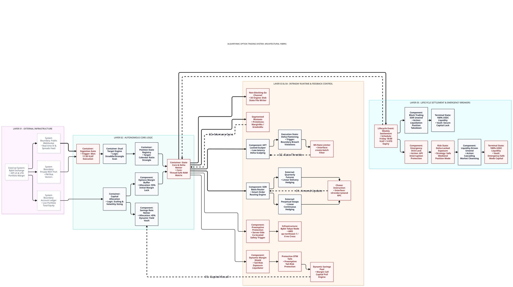

[<kbd> **🇬🇧 English** </kbd>](#english)    [<kbd> **🇷🇺 Русский** </kbd>](#русский)

---

# English

## SHIELD v4.99: Autonomous Derivative Risk-Management Framework

      

**Project Status:** `Active R&D / Continuous Modernization Phase`.

**Infrastructure Evolution:**
Rooted in a practical manual trading system, the framework architecture is actively evolving toward institutional infrastructure standards and is currently open for strategic engineering collaboration, liquidity provisioning partnerships, and prime-brokerage infrastructure integration.
As part of this industry adaptation, the execution matrix of the SHIELD v4.99 suite is undergoing a fundamental overhaul, transitioning from retail-grade setups to industrial specifications for institutional algorithmic trading. To achieve this, low-level bare-metal latency mitigation techniques and execution limit optimizations, engineered specifically for the Bybit V5 API core, are being integrated directly into the Go runtime:
- **Amend-Driven Memory Execution:** High-frequency spread capture via the `Mid-Price Chaser` engine is executed strictly through atomic `v5/order/amend` instructions. By modifying parameters directly inside the exchange matching engine's memory matrix, the system maintains strict queue priority (**Time Priority**). This bypasses the structural network latency and Order ID desynchronization failures inherent to legacy `Cancel + Place` sequences during severe high-volatility bottlenecks.
- **Transactional Bulk Pipelines:** To guarantee systematic rate-limit immunity during option expiration spikes or aggressive delta-hedging cycles (f ≥ 45/sec), the state machine switches into a batch processing topology. Single limit operations are consolidated into atomic multi-order payloads via `v5/order/create-batch`, insulating the system's execution edge from clearinghouse rate-limit drops.
- **Abstracted Transport Layer (FIX/FAST Readiness):** The framework features a deeply decoupled network I/O layer. While currently operating over high-throughput WebSocket and REST JSON streams, the execution pipelines are architecturally prepared for a seamless, drop-in transition to the ultra-low-latency binary **FIX/FAST** protocol as soon as institutional infrastructure partners provide direct FIX gateway access.

This document provides a high-level architectural specification of the **SHIELD v4.99** autonomous derivative execution framework [Bybit, 2026]. The system is engineered to manage multi-asset delta-neutral structures on high-liquidity derivative desks (specifically targeting SOL and ETH networks) under unified risk accounts with Portfolio Margin configurations (PM stress-matrix matching) [Bybit, 2026].

The framework operates under a modular, highly decoupled architecture running inside a native Go (Golang) compiled runtime on customized Linux-based instances [Bybit, 2026].

1. CAPITAL COMPOUNDING & ALLOCATION LOGIC

The framework implements a dynamic, weekly (Monday-to-Monday) compounding mechanism that automatically scales trading parameters based on the live Account Ledger and Total Portfolio Equity (E) [Bybit, 2026].

- **Options Collateral Segment:** Limited strictly to a maximum of 55% of total portfolio equity (GOLimitRate = 0.55) [Bybit, 2026].
- **Liquidity Reserve Segment:** Holds a mandatory 45% minimum buffer of total equity (Cash_Buffer = 0.45) [Bybit, 2026]. This capital is programmatically deployed into interest-bearing flexible vaults (Yield Netting) to offset execution drag while remaining fully credited as margin collateral in the exchange stress-testing matrix [Bybit, 2026].
- **Asset Cross-Allocation:** Capital allocation limits are non-transferable between separate asset subsystems and are strictly mapped to risk-weighted tiers [Bybit, 2026].

2. PRE-TRADE MARKET FRICTION FILTRATION (MFG ENGINE)

Before any structural positions are deployed or modified during the weekly initialization window (Mondays at 11:30 VLAT (UTC+10)), the state machine routes market parameters through a three-stage validation gateway called the **Market Friction Guard (MFG)** [Bybit, 2026]:

1. **Volatility Term Spread:** Scans the implied volatility ratio between short-dated front contracts and back-month tranches to prevent execution under abnormal inverted curve structures (\(Ratio_TS\)) [Bybit, 2026].
2. **Market Maker Spread Velocity:** Tracks the derivative bid-ask spread expansion speed over a 10-minute trailing window (\(V_{s}\)) [Bybit, 2026].
3. **Order Book Density-to-OI Slip:** Validates top-of-book market liquidity against the contract’s aggregate Open Interest (\(OI\_slip\)) [Bybit, 2026].

Additionally, a pre-trade **PM Risk Parser** queries private REST ports to adjust scaling intercepts dynamically based on live exchange stress-test parameters, shifting position targets if clearinghouse risk models tighten [Bybit, 2026].

3. STRUCTURAL LOCALIZATION & EXECUTION MATRIX

The positioning subsystem scanning core performs an automated grid search to localize separate execution zones for directional risk vectors (\(K_{\text{Call}}\) and \(K_{\text{Put}}\)) [Bybit, 2026].

- **Asymmetric Volatility Skew Filtering:** Dual-channel scanners decouple implied volatility surfaces of concurrent maturities to calculate structural skew differentials [Bybit, 2026].
- **Dynamic Target Intercept Tracking:** Target delta zones are continuously updated as a continuous function of short-term volatility indicators (BBWP) combined with live exchange risk matrices, ensuring structural boundaries match fat-tailed asset distributions [Bybit, 2026].
- **Mid-Price Chaser Execution:** Order placement uses a logarithmic chaser sub-module [Bybit, 2026]. The execution engine computes the instantaneous fair mid-price and routes Post-Only limit orders with a 1-tick inward spread displacement, forcing market-maker matching systems to trade against the framework's liquidity [Bybit, 2026].

4. INTRADAY DELTA-NETTING & HIGH-FREQUENCY SCALPING

The internal state core aggregates the Greeks of all underlying option legs and linear hedges into a unified, thread-safe asynchronous matrix, computing the total portfolio net delta (\(D_{\text{Total}}\)) in real time [Bybit, 2026].

- **SOR Basis Router:** A smart routing engine monitors the annualized implied yield of linear instruments [Bybit, 2026]. If basis divergence exceeds threshold limits, delta-hedging volume is automatically routed to quarterly delivery futures to harvest basis convergence premiums [Bybit, 2026]. Otherwise, liquidity is cleared through perpetual swaps [Bybit, 2026].
- **HFT Locked-Scalper:** A continuous, low-latency loop scalps micro-drifts in portfolio net delta using linear instruments [Bybit, 2026]. The dynamic hedging step automatically compresses or expands based on short-term gamma variance and fee-tier profiles [Bybit, 2026].
- **Delta-Flattening Override:** If spot prices violently breach structural break-even boundaries, the active scalping logic is suppressed [Bybit, 2026]. The framework instantly enters a hard-locking execution state, dropping active queues to prioritize cross-market delta immunization [Bybit, 2026].
- **Tail-Risk Mitigation Control:** During periods of extreme backwardation or systemic risk-parameter shifts, the framework activates an automated **Dynamic Margin Shield** [Bybit, 2026]. It programmatically secures defensive, ultra-deep out-of-the-money tranches to cap the maximum theoretical portfolio loss [Bybit, 2026]. This structural overlay reduces maintenance margin requirements by 30-40% under PM stress simulations, insulating the account from liquidation events during extreme ±40% spot crashes [Bybit, 2026].

5. PREEMPTIVE SAFETY NETWORKS & ASYNCHRONOUS FAULT MITIGATION

The system embeds an enterprise-grade infrastructure layer to eliminate the four classical single points of failure inherent to crypto-derivative APIs [Bybit, 2026]:

1. **Race Conditions & Memory Deadlocks (Concurrency Protection):** Global mutex usage is forbidden [Bybit, 2026]. The internal state is protected via isolated synchronization primitives: `marginMu sync.RWMutex` (balances), `greeksMu sync.RWMutex` (net delta loops), and `orderMu sync.Mutex` (chaser transactions) [Bybit, 2026]. Input feeds use a 100ms WebSocket debounce filter [Bybit, 2026].
2. **Rate-Limit Protocol Protection (WS Drop Bypass):** If high-frequency delta fluctuations cause order velocity to surge toward exchange API limits (f ≥ 45/sec), the runtime switches to transactional bulk pipelines (`v5/order/create-batch`), packing operations into multi-order payloads [Bybit, 2026].
3. **I/O Storage Buffer Overflow:** System state serialization (`state.json`) is managed through a non-blocking Go channel with an asynchronous `select` selector, preventing disk I/O bottlenecks from halting trading loops [Bybit, 2026].
4. **Order ID Sync & Nonce Race Mismatches:** The `Mid-Price Chaser` executes updates strictly via atomic **`v5/order/amend`** instructions [Bybit, 2026]. Orders are modified directly inside the exchange matching engine's memory matrix without dropping place-in-queue priorities or risking Order ID synchronization loss [Bybit, 2026].
5. **Dynamic Savings Liquidity Control:** If volatility indicators spike (BBWP > 45), the system automatically withdraws up to 70% of the interest-bearing cash buffer back to the live trading account, ensuring instantly accessible liquidity to backstop linear hedges under extreme stress [Bybit, 2026].

6. LIFECYCLE SETTLEMENT & EMERGENCY OCO-LOCK CIRCUITS

- **Standard Settlement Route:** Front options expire automatically via the clearinghouse at Friday 18:00 VLAT (UTC+10) [Bybit, 2026]. At 18:00:05 VLAT (UTC+10), the runtime reads the exact residual delta of long back-month positions and locks it to absolute zero (\(D_{\text{Total}} \to 0\)) via perpetual contracts [Bybit, 2026]. Back positions are then dissolved via progressive slices using the OTC Block Trading gateway based on top-of-book depth [Bybit, 2026].
- **Emergency Weekend OCO-Lock (Force Majeure Bypass):** If Friday liquidity collapses (spreads > 35%) or exchange API gateways fail, the framework engages the emergency weekend circuit (`SLICING_LIQUIDITY_CRISIS`) [Bybit, 2026]. It completely freezes option modification queues, locks the aggregate delta via a hard linear hedge, and deploys a sleeping OCO conditional pair directly to the exchange server node in Tokyo (0 ms network cross) [Bybit, 2026]. This structure safely transfers portfolio exposure through the weekend market closures, with a scheduled **Liquidity-Driven Unwind Engine** executing a staggered liquidation loop on Monday morning at 11:00 VLAT (UTC+10) [Bybit, 2026].

---

[<kbd> **🇬🇧 English** </kbd>](#english)    [<kbd> **🇷🇺 Русский** </kbd>](#русский)

# Русский

## SHIELD v4.99: Автономный программный комплекс управления рисками деривативов

      

**Статус проекта:** `Активная фаза R&D / Непрерывная модернизация`.

**Эволюция инфраструктуры:**
Базируясь на практической ручной торговой системе, архитектура комплекса планомерно переводится на инфраструктурные стандарты институционального уровня. В настоящее время проект открыт для стратегического технического сотрудничества, интеграции с провайдерами ликвидности и подключения к прайм-брокерской инфраструктуре.
В рамках этой индустриальной адаптации матрица исполнения комплекса SHIELD v4.99 фундаментально перерабатывается, осуществляя переход от ритейл-решений к промышленным спецификациям для институционального алготрейдинга. Для достижения этой цели низкоуровневые методы минимизации латентности (Bare-Metal Latency Mitigation) и оптимизации лимитов исполнения, спроектированные непосредственно под ядро Bybit V5 API, интегрируются напрямую в Go-рантайм:
- **Атомарные модификации в памяти (Amend-Driven Execution):** Модуль высокочастотного преследования спреда `Mid-Price Chaser` осуществляет ведение ордеров строго через инструкции `v5/order/amend`. Параметры заявок изменяются непосредственно внутри оперативной памяти мэтчингового ядра биржи. Это позволяет полностью сохранять временной приоритет в очереди (**Time Priority**) и исключает риски рассинхронизации Order ID или потери сетевых пакетов, характерные для устаревших связок `Cancel + Place` в моменты экстремального всплеска волатильности.
- **Пакетные транзакционные конвейеры (Bulk Pipelines):** Для обеспечения абсолютного протокольного иммунитета к биржевым лимитам во время экспирационных сессий или агрессивных циклов дельта-хеджирования (f ≥ 45/сек), стейт-машина автоматически перестраивает топологию обработки данных. Одиночные операции упаковываются в единые мульти-ордерные полезные нагрузки через метод `v5/order/create-batch`, что надежно защищает контур исполнения от сброса соединений со стороны клиринга (Rate-Limit Drops).
- **Абстракция транспортного слоя (Готовность к FIX/FAST):** Сетевой I/O слой фреймворка полностью изолирован от бизнес-логики. Текущая WebSocket/REST JSON-архитектура концептуально подготовлена к бесшовному («drop-in») переходу на бинарный протокол **FIX/FAST**. Переключение на ультранизколатентный интерфейс произойдет автоматически, как только инфраструктурный партнер предоставит прямой институциональный FIX-доступ к шлюзам биржи.

Настоящий документ содержит высокоуровневое описание архитектуры автономного деривативного торгового комплекса **SHIELD v4.99** [Bybit, 2026]. Система спроектирована для автоматического управления мультиактивными дельта-нейтральными структурами на высоколиквидных деривативных площадках (целевые сети — SOL и ETH) внутри Единого торгового аккаунта в режиме Portfolio Margin (кросс-зачет маржи по стресс-матрицам PM) [Bybit, 2026].

Комплекс представляет собой модульную, слабосвязанную архитектуру, функционирующую внутри скомпилированной исполняемой среды на Go (Golang) на кастомизированных серверах под управлением Linux [Bybit, 2026].

1. ДИНАМИЧЕСКИЙ КОМПАУНДИНГ И АЛЛОКАЦИЯ КАПИТАЛА

Рантайм реализует механизм еженедельного (Monday-to-Monday) пересчета торговых лимитов на основе фактического баланса аккаунта и общего значения Эквити портфеля (E) [Bybit, 2026].

- **Сегмент обеспечения опционов:** Жестко ограничен максимальным значением в 55% от текущего общего Эквити аккаунта (GOLimitRate = 0.55) [Bybit, 2026].
- **Сегмент ликвидного резерва:** Удерживает обязательный маржинальный буфер в размере не менее 45% от общего Эквити (Cash_Buffer = 0.45) [Bybit, 2026]. Данный капитал программно размещается в гибких процентных смарт-пулах (Yield Netting) для снижения издержек на уплату биржевого трения, полностью сохраняя при этом статус зачетного маржинального обеспечения в стресс-матрице брокера [Bybit, 2026].
- **Кросс-активное распределение маржи:** Лимиты обеспечения между изолированными субсистемами разных активов нелинейно разграничены и не подлежат взаимному переливу во избежание каскадного маржинального сквиза [Bybit, 2026].

2. ПРЕ-ТРЕЙД КРАШ-ФИЛЬТРАЦИЯ СТАКАНА (МЕХАНИЗМ MFG)

Перед развертыванием или модификацией структурных позиций в понедельник в стартовое инициализационное окно (11:30 VLAT (UTC+10)), стейт-машина принудительно пропускает рыночные параметры через трехступенчатый шлюз валидации **Market Friction Guard (MFG)** [Bybit, 2026]:

1. **Временной спред волатильности:** Оценивает соотношение подразумеваемой волатильности ближней и дальней серий контрактов для предотвращения входа в рынок в моменты аномальной инверсии кривой волатильности (\(Ratio_TS\)) [Bybit, 2026].
2. **Скорость расширения спредов маркет-мейкеров:** Фиксирует динамику уширения спреда топ-брокеров за 10-минутный скользящий интервал (\(V_{s}\)) [Bybit, 2026]. При пробое порога \(V_s > 0.35\) вход блокируется.
3. **Плотность стакана к Открытому Интересу:** Проверяет объем ликвидности в Top-5 лимитных ордерах опционного деска относительно кумулятивного Open Interest выбранного страйка (\(OI\_slip\)) во избежание транзакционных потерь [Bybit, 2026].

Дополнительно пре-трейд горутина **PM Risk Parser** опрашивает приватные REST-порты спецификаций биржи, автоматически корректируя целевые дельты входа, если клиринговый дом кулуарно ужесточает риск-параметры матриц [Bybit, 2026].

3. ЛОКАЛИЗАЦИЯ СТРУКТУРЫ И МАТРИЦА ИСПОЛНЕНИЯ

Вычислительное сканирующее ядро производит автоматизированный Grid Search для поиска изолированных зон развертывания направленных риск-векторов (\(K_{\text{Call}}\) и \(K_{\text{Put}}\)) [Bybit, 2026].

- **Асимметричный волатильный Skew-неттинг:** Двухканальные потоковые сканеры разделяют поверхности подразумеваемой волатильности разных сроков экспирации для вычисления межсерийных дифференциалов скоса [Bybit, 2026].
- **Динамический трекинг целевых интерцептов:** Целевые дельты непрерывно адаптируются на основе текущих четырехчасовых индикаторов волатильности (BBWP) и актуальных стресс-матриц PM, гарантируя соответствие границ позиций «жирным хвостам» (Fat Tails) распределения доходности актива [Bybit, 2026].
- **Исполнение через Mid-Price Chaser:** Выставление ордеров делегировано логарифмическому модулю преследования спреда [Bybit, 2026]. Движок рассчитывает мгновенную справедливую цену Mid и выставляет Post-Only лимитные ордера со смещением в 1 тик внутрь спреда, принуждая алгоритмы маркет-мейкеров исполняться об ордер робота [Bybit, 2026].

4. ИНТРАДЕЙ ДЕЛЬТА-НЕТТИНГ И ВЫСОКОЧАСТОТНЫЙ ГАММА-СКАЛЬПИНГ

Внутреннее ядро асинхронно агрегирует текущие греки всех опционных ног и линейных инструментов хеджирования в единую потокобезопасную RAM-матрицу, вычисляя чистую дельту портфеля (\(D_{\text{Total}}\)) в режиме реального времени [Bybit, 2026].

- **SOR Basis Router:** Смарт-роутер мониторит годовую процентную ставку контанго/бэквордации линейного рынка [Bybit, 2026]. При выходе базисного спреда за целевые лимиты дельта-хеджирование автоматически перенаправляется на **Срочные Квартальные фьючерсы** для фиксации премии схождения базиса [Bybit, 2026]. В остальных случаях объем очищается через бессрочные свопы (Perps) [Bybit, 2026].
- **HFT Locked-Scalper:** Низколатентный непрерывный поток скальпирует микро-дрейф нетто-дельты портфеля линейными фьючерсами [Bybit, 2026]. Шаг ордеров HFT-робота автоматически расширяется или сужается в зависимости от текущей интрадей-вариации Гаммы портфеля и VIP-тарифа аккаунта [Bybit, 2026].
- **Режим Delta-Flattening:** При форс-мажорном импульсном выходе спот-цены за расчетные границы безубыточности, логика скальпинга блокируется. Робот переходит в жесткий режим заморозки рисков, сбрасывая лимитные очереди ордеров и выравнивая кумулятивную дельту портфеля строго в ноль по рынку [Bybit, 2026].
- **Контур опережающей защиты хвостов:** В фазах бэквордации или системного изменения риск-векторов, ядро активирует встроенный модуль **Dynamic Margin Shield** [Bybit, 2026], для жесткой фиксации максимального теоретического убытка [Bybit, 2026]. Данный защитный оверлей снижает поддерживающую маржу PM на 30-40% на уровне ядра биржи, полностью исключая маржин-колл аккаунта при экстремальных рыночных шоках спота на ±40% [Bybit, 2026].

5. ПРЕВЕНТИВНАЯ ЗАЩИТА РАНТАЙМА И АСИНХРОННАЯ ЛИКВИДАЦИЯ ТОЧЕК ОТКАЗА API

Инфраструктурный слой комплекса разработан на Golang с целью полной ликвидации четырех классических уязвимостей биржевых API-интерфейсов [Bybit, 2026]:

1. **Дедлоки и Race Condition (Защита памяти):** Использование глобальных мьютексов КАТЕГОРИЧЕСКИ ЗАПРЕЩЕНО [Bybit, 2026]. Стейт разделен на изолированные примитивы синхронизации: `marginMu sync.RWMutex` (балансы маржи), `greeksMu sync.RWMutex` (неттинг дельты), `orderMu sync.Mutex` (атомарность транзакций Chaser-а) [Bybit, 2026]. Поток WebSocket снабжен 100-миллисекундным дебаунс-фильтром [Bybit, 2026].
2. **Протокольный WS Rate-Limiter:** При дрейфе дельты на волатильных экспирациях и превышении частоты ордеров порога запросов (f ≥ 45/sec), рантайм склеивает одиночные лимитки в пакетные Bulk-транзакции (`v5/order/create-batch`), предотвращая сброс соединения биржей [Bybit, 2026].
3. **Защита дискового буфера ввода-вывода (I/O):** Сериализация состояния системы (`state.json`) вынесена в неблокирующий Go-канал со сквозным селектором `select`, исключая аппаратное зависание торговых горутин при забивании системного кэша диска [Bybit, 2026].
4. **Синхронизация Order ID и Nonce-параметров:** Модуль `Mid-Price Chaser` осуществляет ведение ордера строго через метод **`v5/order/amend`** [Bybit, 2026]. Цена модифицируется в памяти мэтчингового ядра биржи без снятия ордера из стакана, обнуляя риски потери места в очереди и риска рассинхронизации ордеров при сетевых лагах связок Cancel+Place [Bybit, 2026].
5. **Динамический пулл-контроль стейкинга:** При росте волатильности (BBWP > 45), система автоматически выводит до 70% свободного кэш-буфера из Bybit Savings обратно на баланс UTA, гарантируя мгновенное наличие ликвидности для обеспечения встречных дельта-хеджей фьючерсов [Bybit, 2026].

6. КЛИРИНГ СЕССИИ, ЭКСПИРАЦИЯ И АВАРИЙНЫЕ КЛАПАНЫ ТОКИО

- **Штатный клиринговый маршрут:** Ближние ноги автоматически экспирируются биржевым движком в пятницу в 18:00 VLAT (UTC+10) [Bybit, 2026]. В 18:00:05 VLAT (UTC+10), бот считывает чистую остаточную дельту дальних лонгов (\(Delta\_Long\)) и намертво запечатывает её фьючерсным локом Bybit Perps до уровня строго 0.00 [Bybit, 2026]. Демонтаж лонгов выполняется после 19:15 VLAT (UTC+10) пошаговыми слайсами через OTC-шлюз Block Trading v5 под объем реального стакана Top-3 Bids [Bybit, 2026].
- **Аварийный уик-энд ОСО-шлюз (Форс-мажорный контур):** Если в пятницу к 19:58:50 VLAT (UTC+10) стаканы пусты (маркет-спред > 35%) или API биржи лагает, активируется статус `SLICING_LIQUIDITY_CRISIS` [Bybit, 2026]. Робот замораживает опционные очереди, фиксирует дельту лонгов фьючерсным локом и отправляет спящую пару OCO-условных ордеров со смещением ±2% напрямую на серверный узел Bybit в Токио (сетевой лаг 0 мс) [Bybit, 2026]. Контур безопасно переносит позицию через выходные, а в понедельник в 11:00 VLAT (UTC+10) активируется **Liquidity-Driven Unwind Engine**, каскадно очищающий аккаунт в 100% USDC-кэш к 11:20 VLAT (UTC+10) [Bybit, 2026].
---

[<kbd> **🇬🇧 English** </kbd>](#english)    [<kbd> **🇷🇺 Русский** </kbd>](#русский)

